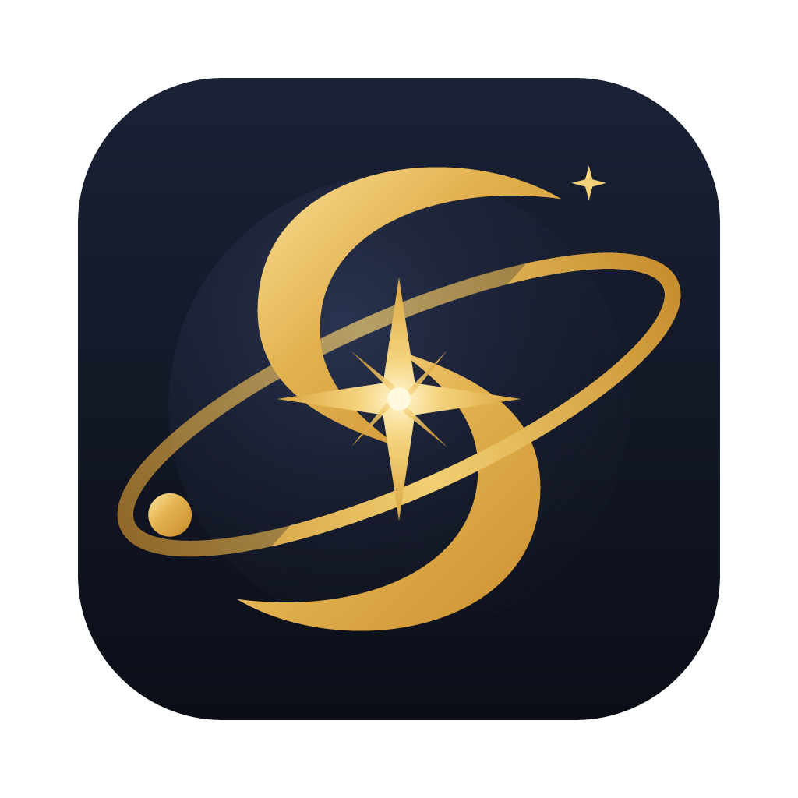
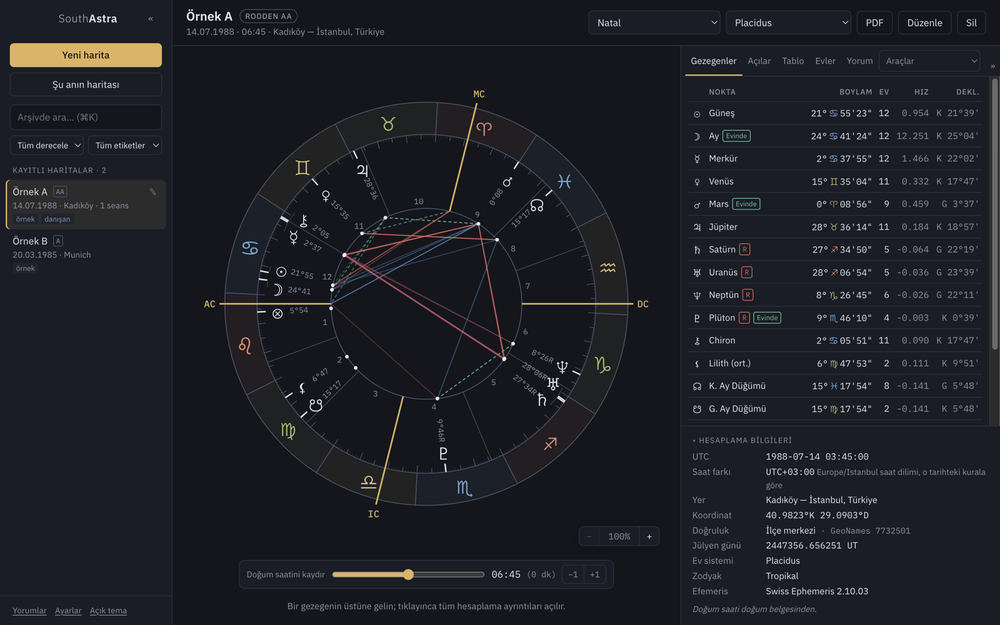
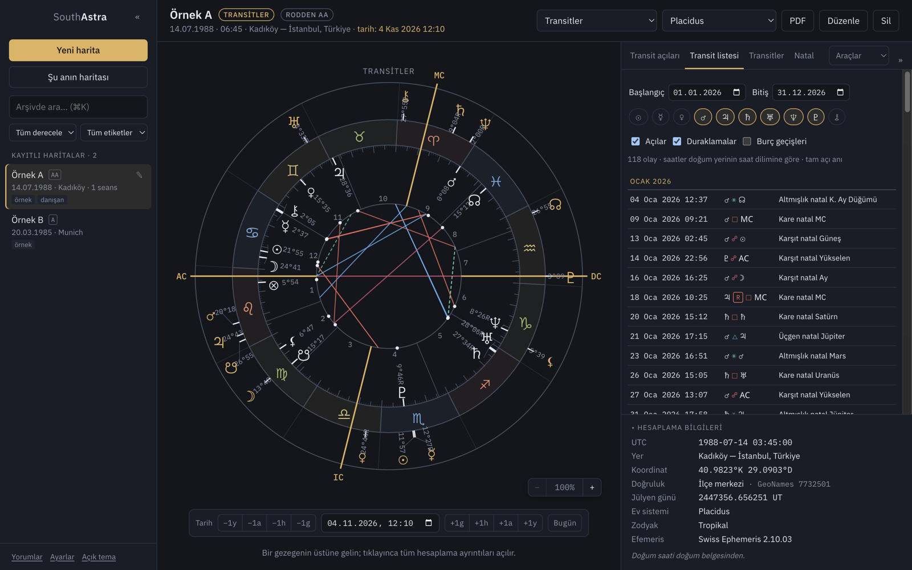
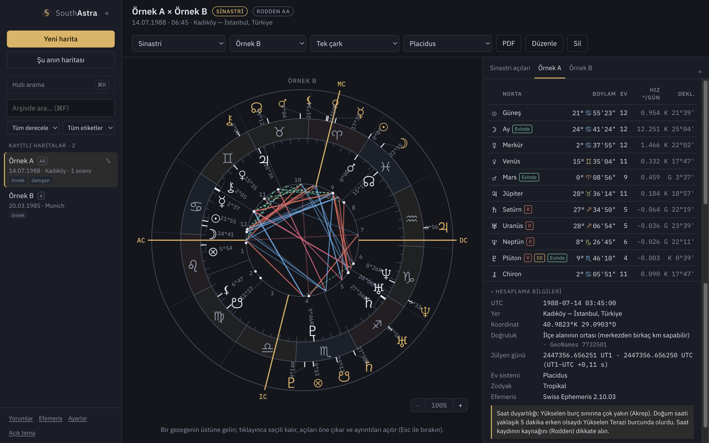
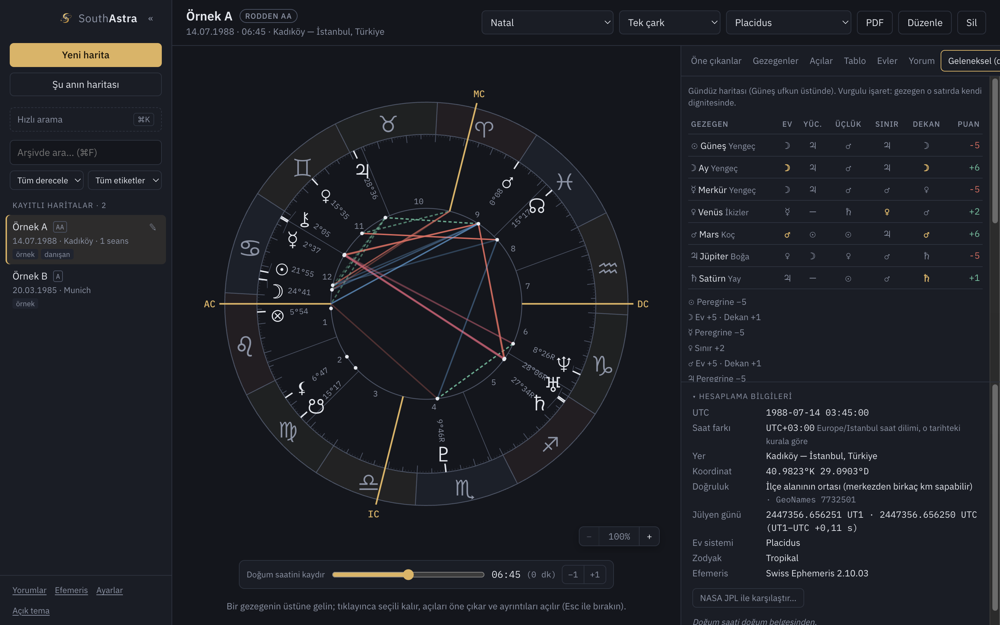
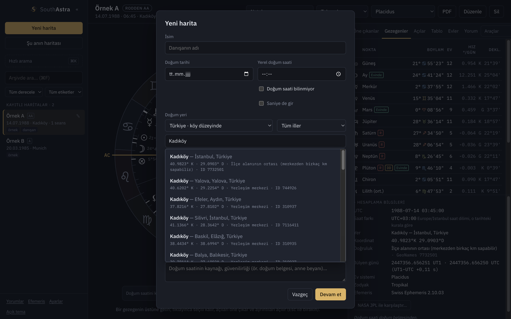
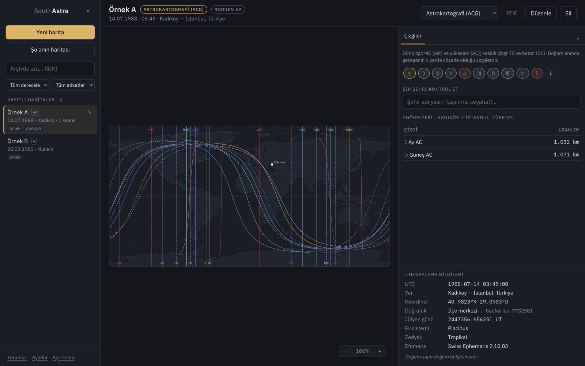
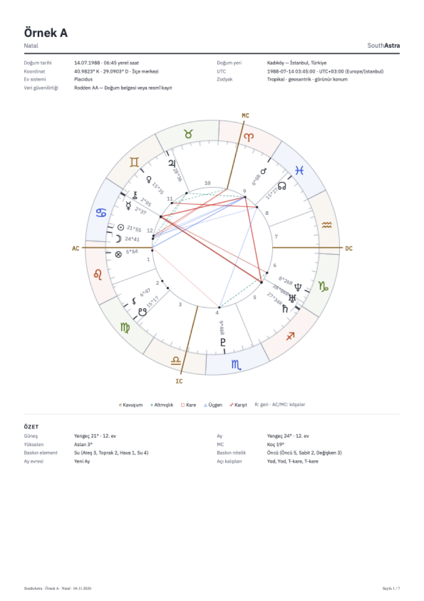

<p align="center"></p>

<h1 align="center">SouthAstra</h1>

Profesyonel astrologlar için masaüstü astroloji programı. Mac ve Windows'ta çalışır.

Hesaplamalar, Astrodienst'in **Swiss Ephemeris** motoruyla yapılır (NASA JPL efemerislerine dayanır; astro.com ile aynı motor).

## Ekran görüntüleri

Görsellerdeki haritalar uydurma örneklerdir.

| | |
|---|---|
|  |  |
| **Doğum haritası** — çark, gezegen tablosu, hesaplama bilgileri | **Transitler** — çift çark ve tam açı anlarıyla transit listesi |
|  |  |
| **Sinastri** — iki harita ve karşılıklı açılar | **Geleneksel analiz** — esas dignite tablosu, karşılıklı ağırlama, dispozitörler |
|  |  |
| **Doğum yeri** — ülke / il / ilçe süzgeci, koordinat ve GeoNames kimliği | **Astrokartografi** — gezegen çizgileri ve şehir uzaklıkları |

<p align="center"><br><b>PDF raporu</b> — bölümlü, sayfa numaralı A4 çıktı</p>

## Özellikler

**Haritalar**
- Natal, drakonik, harmonik (4–16), astrokartografi (ACG dünya haritası, şehir–çizgi uzaklıkları)
- Transit, ikincil / tersiyer / minör progresyon, solar arc (çift çark)
- Güneş dönüşü, Ay dönüşü, sinastri, kompozit (orta nokta)
- 11 ev sistemi, tropikal veya sideral zodyak (Lahiri, Fagan/Bradley, Raman, KP ve diğerleri)
- Gezegenler, Chiron, Lilith, gerçek/ortalama Ay düğümleri, Şans Noktası (gündüz/gece), AC/MC/Vertex

**Analiz**
- Majör ve minör açılar, paralel/kontraparalel, ayarlanabilir orb profilleri (Standart, Dar, Geniş, Özel)
- Transit listesi: tam açı anları, duraklamalar ve burç geçişleri (dakika hassasiyetinde)
- Açı kalıpları: büyük üçgen, T-kare, büyük haç, Yod, uçurtma, mistik dikdörtgen, stelyum
- Esas dignite tablosu (ev, yücelim, üçlük, Mısır sınırları, Kalde dekanları; Lilly puanlaması), karşılıklı ağırlama, dispozitör zincirleri
- Orta nokta temasları (90° kadran), tutulmalar (doğum öncesi ve yaklaşanların natal temasları)
- Element/nitelik/yarımküre dağılımı, Ay evresi, sabit yıldız kavuşumları
- Ev sistemi karşılaştırması: hangi gezegenin evi değişiyor
- Gezegen detay paneli: ekliptik ve ekvatoral koordinatlar, hız, uzaklık, azimut/yükseklik, ondalık ev, JD (UT/TT), ΔT, eğim, yerel yıldız zamanı

**Doğum saati**
- Tarihsel saat dilimi ve yaz saati (IANA tz), belirsiz/atlanan saat uyarıları, LMT, elle ofset
- Saat bilinmiyorsa evler gizlenir, Ay'ın olası aralığı gösterilir
- Saat aralığı tablosu ve dakika dakika saat kaydırıcı (basit rektifikasyon)
- Rodden güvenilirlik derecesi

**Yer**
- Çevrimdışı veritabanı: dünyada 170 binden fazla yerleşim; Türkiye ve Almanya köy/semt düzeyinde
- Ülke ve il/eyalet süzgeci, GeoNames kimliği, konum doğruluğu, elle kesin koordinat
- Hesaplama öncesi doğrulama ekranı

**Danışan ve iş akışı**
- Kişisel yorum kütüphanesi: her etken için astrologun kendi metni; aynı etken başka haritada çıktığında otomatik gelir (hazır yorum metni yoktur)
- Seans notları ve hayat olayları (olaydan tek tıkla transit / progresyon / solar arc)
- Arşiv: etiketler, Rodden ve metin araması; günlük otomatik yedek (son 30 gün); JSON dışa/içe aktarma
- Bölümlü A4 PDF raporu: harita ve özet, konumlar, açılar, analiz, transit listesi, yorumlar, notlar; sayfa numaralı
- Görünüm ayarı: istenmeyen noktaları (Chiron, Lilith, düğümler…) gizleme
- Klavye kısayolları: ⌘N yeni, ⌘T şu an, ⌘E düzenle, ⌘K ara, ⌘L yorum kütüphanesi, ⌘P PDF, ⌘, ayarlar
- Gece Profesyonel (koyu) ve Sade Profesyonel (açık) tema

## Doğruluk

`npm run verify` testleri:

- Gezegen konumlarını Meeus, *Astronomical Algorithms* örnekleriyle karşılaştırır. Güneş'te JPL DE200 değerinden fark 0,03 yay saniyesi.
- 1850–2050 arasında 10 cismi bağımsız bir teoriyle (Moshier) karşılaştırır. En büyük fark 2 yay saniyesinin altında.
- Saat dilimi, yaz saati geçişi, LMT, ev sistemi ve drakonik harita kurallarını sınar.
- Güneş/Ay dönüşü anında konum farkı 0,001 yay saniyesinin altında; transit listesindeki her tam açı anı yeniden hesaplanarak doğrulanır.
- Sideral (Lahiri) ayanamsa, progresyon (ikincil/tersiyer/minör), solar arc, harmonik, kompozit ve Şans Noktası formüllerini sınar.
- 2026 tutulmalarını NASA kataloğuyla (tarih, saat, tür) karşılaştırır; astrokartografi çizgilerinde gezegenin gerçekten ufukta/meridyende olduğunu doğrular.
- Esas dignite tablolarını geleneksel kaynaklarla sınar: Mısır sınırlarında gezegen toplamları (Satürn 57, Jüpiter 79, Mars 66, Venüs 82, Merkür 76), 36 Kalde dekanı, Lilly üçlük yöneticileri.
- Gerçek Ay düğümü hızını sayısal türevle, Vega'yı Hipparcos koordinatından bağımsız hesapla, orta noktaları ikinci bir yöntemle (birim vektör) doğrular.

Saat dilimi kayıtlarının geçmişi bazı ülkeler ve yıllar için tartışmalıdır. 1985 öncesi Türkiye bunlardan biridir. Program kullandığı ofseti her haritada gösterir, gerekirse elle düzeltilebilir.

## Kurulum (kullanıcılar için)

Hazır kurulum dosyaları GitHub'daki **[Releases](https://github.com/agbalmikail/SouthAstra/releases)** sayfasındadır. Yeni bir sürüm yayınlandığında uygulama açılışta bunu bildirir ve indirme bağlantısı sunar (Ayarlar'dan kapatılabilir).

- **Mac:** `.dmg` dosyasını açın ve SouthAstra'yı Uygulamalar klasörüne sürükleyin. Uygulama imzalı olmadığı için ilk açılışta uygulamaya sağ tıklayın ve **Aç**'ı seçin.
- **Windows:** `.exe` dosyasını çalıştırın. "Windows bilgisayarınızı korudu" uyarısı çıkarsa **Ek bilgi → Yine de çalıştır**'a tıklayın.

## Geliştirme

```bash
npm install
npm run dev        # geliştirme modunda aç
npm run verify     # doğruluk testleri
npm run dist:mac   # Mac kurulum dosyası (dist/)
npm run dist:win   # Windows kurulum dosyası (dist/)
```

Bir sürüm etiketi gönderildiğinde (`git tag v0.1.0 && git push --tags`) GitHub, Mac ve Windows kurulum dosyalarını otomatik üretir.

Yer veritabanını yenilemek için GeoNames'ten `cities1000.txt`, `TR.txt`, `admin1CodesASCII.txt`, `admin2Codes.txt` ve `countryInfo.txt` dosyalarını bir klasöre indirin, sonra `node scripts/build-cities.mjs <klasör>` komutunu çalıştırın.

## Lisans

© 2026 SouthAstra katkıcıları.

SouthAstra, **GNU Affero General Public License v3.0** (AGPL-3.0) ile lisanslanmıştır. Ayrıntılar için [LICENSE](LICENSE) dosyasına bakın.

Kullanılan kaynaklar:

- **Swiss Ephemeris** © Astrodienst AG, Zürih. AGPL-3.0 ile kullanılmaktadır. https://www.astro.com/swisseph/
- **GeoNames** yer verisi, CC BY 4.0. https://www.geonames.org/
- **Natural Earth** dünya haritası verisi, kamu malı. https://www.naturalearthdata.com/
- **IBM Plex** ve **Noto Sans Symbols** yazı tipleri, SIL Open Font License 1.1

Bütün üçüncü taraf bileşenlerin lisans metinleri [THIRD_PARTY_NOTICES.md](THIRD_PARTY_NOTICES.md) dosyasındadır; uygulamada **Hakkında** penceresinden de görülebilir.
